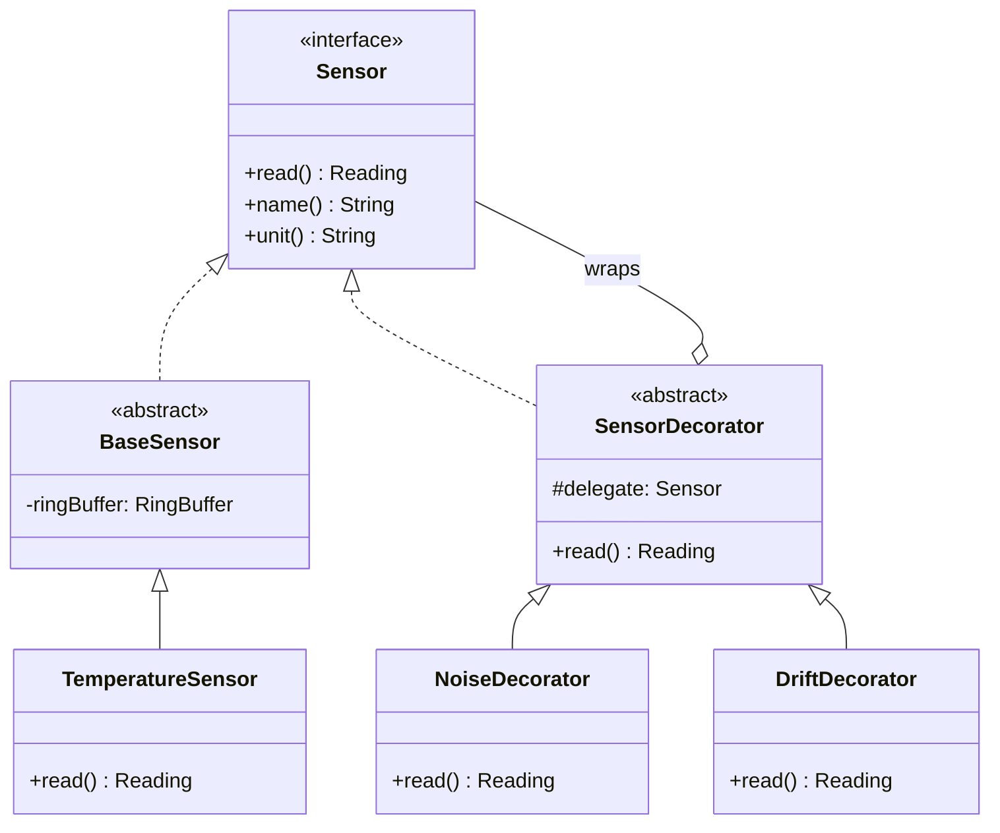
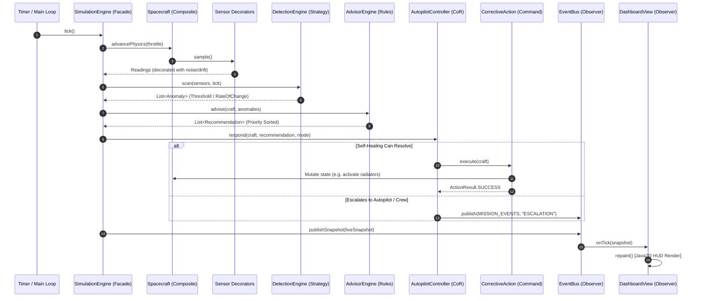

# OrbitalX: Comprehensive Object-Oriented Programming (OOP) Architectural Guide

> **Core Mission**: OrbitalX is designed from first principles as an aerospace mission-control simulator demonstrating how enterprise-grade Object-Oriented Programming (OOP), SOLID design principles, and classical GoF Design Patterns model complex, deterministic, distributed mission-critical avionics in pure Java 17.

---

## Table of Contents
1. [Project Directory & Package Structure](#1-project-directory--package-structure)
2. [Module Architecture & Architectural Boundaries](#2-module-architecture--architectural-boundaries)
3. [The Core OOP Pillars in OrbitalX](#3-the-core-oop-pillars-in-orbitalx)
   - [Encapsulation & Defensive Programming](#encapsulation--defensive-programming)
   - [Inheritance & Polymorphism](#inheritance--polymorphism)
   - [Interface Segregation & Contracts](#interface-segregation--contracts)
   - [Abstraction & Domain Boundaries](#abstraction--domain-boundaries)
4. [Classical Design Patterns & Architectural Implementation](#4-classical-design-patterns--architectural-implementation)
   - [Behavioral Patterns](#behavioral-patterns)
   - [Structural Patterns](#structural-patterns)
   - [Creational Patterns](#creational-patterns)
5. [End-to-End Execution Trace: Telemetry to Remediation](#5-end-to-end-execution-trace-telemetry-to-remediation)
6. [Design Verification & Testing Strategy](#6-design-verification--testing-strategy)

---

## 1. Project Directory & Package Structure

OrbitalX is strictly organized by functional domain responsibilities. Every component is isolated within a dedicated package under `com.orbitalix`:

```text
c:\Users\Bharat Upadhyay\OneDrive\Desktop\OrbitalX\
├── compile.bat / compile.sh              # Headless zero-dependency Java 17 compilation
├── run.bat / run.sh                      # Unified runtime launcher (GUI, CLI, SelfTest)
├── docs/                                 # Technical documentation & architectural diagrams
│   ├── ARCHITECTURE.md                  # High-level architecture summary
│   ├── OOP_GUIDE.md                     # This comprehensive OOP guide
│   ├── OOP_CONCEPT_MAP.md               # Quick concept-to-file traceability map
│   ├── puml/                            # PlantUML domain diagrams
│   └── screenshots/                     # UI verification captures across themes
└── src/main/java/com/orbitalix/
    ├── action/                           # Command Pattern: Executable corrective actions
    ├── advisor/                          # Rule Engine / Strategy: Fault diagnosis & recommendations
    ├── api/                              # Public Boundary: Interfaces, snapshots (Records), and enums
    ├── app/                              # Application bootstrap & entry point (Main)
    ├── autonomy/                         # Chain of Responsibility & Policy: Auto-recovery engine
    ├── comms/                            # Strategy / Queue: Delayed & direct uplink channels
    ├── config/                           # Abstract Factory & Builder: Missions, crafts, destinations
    ├── console/                          # Command Parser & Registry: Command-line terminal interface
    ├── crew/                             # Composite / Role Hierarchy: Crew members and task allocation
    ├── detection/                        # Strategy Pattern: Real-time telemetry anomaly detectors
    ├── event/                            # Observer Pattern: Strongly-typed event bus and pub/sub
    ├── exception/                        # Domain Exception Hierarchy: Checked & unchecked avionics faults
    ├── fault/                            # Factory & Target: Dynamic fault injection engine
    ├── gui/                              # Presentation Layer (Swing / Java2D hardware-accelerated HUD)
    │   ├── anim/                         # Animation, particle systems, easing strategies, screen shake
    │   ├── audio/                        # Strategy: Synthesized waveform audio vs. silent fallback
    │   ├── core/                         # View registry, base view lifecycle, shortcuts, splash
    │   ├── kit/                          # Custom UI components (Gauges, Charts, Cards, ToastLayer)
    │   ├── render3d/                     # Software 3D Renderer: Matrix math, meshes, camera, pipeline
    │   └── theme/                        # Strategy / Flyweight: 4 High-contrast mission themes
    ├── model/                            # Core Domain Model: Spacecraft, Subsystems, Operating Limits
    ├── replay/                           # Memento Pattern: Historical telemetry snapshots & scrubber
    ├── report/                           # Visitor Pattern: HTML, CSV, and text mission debrief exports
    ├── resource/                         # Consumables model: Battery, Fuel Tank, Oxygen, Sealant
    ├── scoring/                          # Specification & Observer: Flight grades and achievements
    ├── sensor/                           # Decorator Pattern: Sensors, noise, spikes, drift, stuck values
    ├── simulation/                       # Facade & Engine: Deterministic simulation clock & tick cycle
    ├── state/                            # State Pattern: Spacecraft operational lifecycle states
    ├── util/                             # Generic utilities: RingBuffer, Clock, DeterministicRandom
    └── whatif/                           # Simulation sandbox for lookahead predictive forecasting
```

---

## 2. Module Architecture & Architectural Boundaries

OrbitalX strictly adheres to clean architectural boundaries. High-level policies do not depend on low-level UI details; rather, presentation layers communicate with the simulation solely through an immutable API facade.

```mermaid
graph TD
    UI[GUI Views / Terminal CLI / SelfTest] -->|Crosses API Boundary| Controller[api.SimulationController]
    Controller -->|Delegates to Facade| Engine[simulation.SimulationEngine]
    
    subgraph Core Domain Simulation
        Engine --> Craft[model.Spacecraft]
        Craft --> Subsystems[model.Subsystem Hierarchy]
        Craft --> Resources[resource.Resource Hierarchy]
        Craft --> Sensors[sensor.Sensor & Decorators]
        Craft --> Crew[crew.CrewRoster & CrewMember]
        Craft --> State[state.SpacecraftState Pattern]
    end

    subgraph Autonomous Analysis & Recovery Pipeline
        Engine --> Detectors[detection.DetectionEngine]
        Detectors --> Anomalies[detection.Anomaly]
        Anomalies --> Advisor[advisor.AdvisorEngine]
        Advisor --> Recommendations[advisor.Recommendation]
        Recommendations --> Autonomy[autonomy.AutopilotController]
        Autonomy --> Handlers[Chain of Responsibility: SelfHealing -> Autopilot -> Crew -> Escalation]
        Handlers --> Actions[action.CorrectiveAction Command]
        Actions -->|Mutates State Safely| Craft
    end

    subgraph Telemetry, History & Reporting
        Engine --> EventBus[event.EventBus]
        Engine --> History[replay.History Memento]
        Engine --> Report[report.MissionReport Visitor]
    end
```

### Module Responsibilities:
1. **`api` (Public Contract)**: Defines `SimulationController`, immutable records (`SimulationSnapshot`, `CrewSnapshot`, `ResourceSnapshot`), and system enums. UI components depend *only* on `api`.
2. **`model` & `resource` (Avionics Physics)**: Encapsulates spacecraft components, resources, physical limits, and subsystems.
3. **`sensor` (Telemetry Acquisition)**: Manages physical measurements with dynamic noise and glitch decorations.
4. **`detection` & `advisor` (Diagnostic Intelligence)**: Analyzes telemetry streams to detect out-of-bound anomalies and recommends prioritized corrective actions.
5. **`autonomy` & `action` (Execution & Control)**: Evaluates recommendations through an autonomous Chain of Responsibility and executes Command objects.
6. **`state` (System Lifecycle)**: Manages dynamic state transitions (Nominal, Warning, Critical, Safe Mode).
7. **`gui` (Cybernetic Cockpit HUD)**: Custom-painted Java2D interface offering 10 distinct mission consoles with animated 60 FPS feedback.

---

## 3. The Core OOP Pillars in OrbitalX

### Encapsulation & Defensive Programming
Encapsulation in OrbitalX guarantees that physical telemetry cannot be placed into an invalid or corrupted state from the outside.

* **Defensive Copying in Boundaries**: `model.Spacecraft` and `util.RingBuffer` maintain mutable state internally. When exposing data to the API, snapshots are projected into immutable Java 17 `record` types (`SimulationSnapshot`, `SubsystemSnapshot`), ensuring external threads or views cannot mutate internal state.
* **Bounded Mutators**: Mutators enforce invariants and throw clear domain exceptions when violated:
  ```java
  // In model/Spacecraft.java:
  public synchronized void setThrottle(int value) {
      if (value < 0 || value > 100) 
          throw new IllegalArgumentException("Throttle must be 0..100");
      if (value > limits.get(LimitType.MAX_THROTTLE)) 
          throw new IllegalArgumentException("Throttle exceeds operating limit");
      throttle = value;
  }
  ```
* **Immutable Meshes and Collections**: `gui.render3d.Mesh` clones vertex arrays on construction and retrieval, preventing external tampering with active 3D geometry.

---

### Inheritance & Polymorphism
OrbitalX avoids monolithic `if-else` or `switch` statements for behavioral logic, preferring polymorphic dispatch through inheritance hierarchies:

1. **Subsystems (`model.Subsystem` Hierarchy)**:
   - Base class `Subsystem` provides common health calculations, sensor bindings, and fault maps.
   - Subtypes (`PropulsionSubsystem`, `LifeSupportSubsystem`, `ThermalSubsystem`, `PowerSubsystem`, etc.) specialize telemetry calculations and child component topologies.
2. **Sensors (`sensor.BaseSensor` Hierarchy)**:
   - `BaseSensor` provides ring-buffer caching, calibration, and noise processing.
   - Subclasses (`TemperatureSensor`, `PressureSensor`, `GyroSensor`, `VoltageSensor`, `RadiationSensor`) implement measurement physics:
     ```java
     // Dynamic dispatch via interface:
     Sensor sensor = new TemperatureSensor("temp-core", 24.0);
     Reading r = sensor.read(); // Dispatches polymorphically
     ```
3. **Crew Members (`crew.CrewMember` Hierarchy)**:
   - Base class `CrewMember` tracks stamina, stress, radiation dosage, and task state.
   - Derived classes (`Commander`, `FlightEngineer`, `MedicalOfficer`, `Pilot`) override work efficiency coefficients, task affinities, and specialized skills.

#### Deep Dive: How Crew Tasks Drive Simulation Survival
In OrbitalX, astronauts are not passive passengers; their actions are critical avionics interventions that prevent mission failure:
* **`EVA_REPAIR` (Extravehicular Spacewalk)**: Dispatches an astronaut outside the hull to repair physical hardware failures (`HULL_BREACH`, `FUEL_LEAK`, `SOLAR_FAILURE`, `COOLANT_FAILURE`, `SCRUBBER_FAILURE`). If a hull breach or fuel leak goes unresolved, cabin pressure drops to zero or propellant runs dry, terminating the mission with `LOST - LIFE SUPPORT` or `LOST - FUEL EXHAUSTED`. Flight Engineers receive a 40% duration speed bonus on EVA operations.
* **`MEDICAL_CARE` (Trauma & Stasis Therapy)**: Restores astronaut vitals (+30 HP). Hostile environments (hypoxia, CO2 poisoning, decompression, radiation storms) drain astronaut health every tick. If all crew vitals reach zero, the spacecraft drifts inert and the mission is permanently lost. Medical Officers administer trauma care with accelerated turnaround.
* **`MANUAL_REBOOT` (Avionics Hard Recycle)**: Recycles the flight guidance computers, unfreezing locked CPU threads and resetting error registers (`COMPUTER_FAULT`). When flight computer lockup occurs, automated telemetry and autopilot rules freeze; manual crew intervention is required to restore automated flight control.
* **`REST` (Quarters Recuperation)**: Decreases psychological stress (-30% Stress). Sustained emergencies, extreme temperatures, and alarms cause crew stress to spike. High stress leads to operational paralysis and accelerated vitals degradation.

---

### Interface Segregation & Contracts
OrbitalX specifies 20+ specialized, focused interfaces rather than bloated universal contracts:

* `api.Copyable<T>`: Implements prototype deep-copy semantics without relying on Java's flawed `Cloneable`.
* `api.TickListener`: Single-method listener for synchronous simulation clock steps.
* `api.MissionEventListener`: Push-based contract for asynchronous critical mission events.
* `util.Identifiable`: Common identity contract enabling type-safe lookup generics:
  ```java
  public static <T extends Identifiable> T requireId(Collection<T> items, String id) { ... }
  ```
* `sensor.Sensor`: Clean consumer contract exposing `read()`, `unit()`, and the default method `latest()`.
* `report.ReportVisitor`: Strict visitor contract decoupling reporting data from presentation formats (HTML, CSV, TXT).

---

### Abstraction & Domain Boundaries
Complex physical simulation details are abstracted behind high-level domain concepts:
* The user and autopilot interact with `CorrectiveAction` without needing to know whether thruster valve solenoid #2 is firing or if fuel cross-feed manifold lines are cycling.
* The graphical HUD views interact strictly with `SimulationController`, insulating UI rendering code completely from the differential equations governing propulsion burn or thermodynamic cooling.

---

## 4. Classical Design Patterns & Architectural Implementation

OrbitalX serves as a comprehensive catalog of classical Gang of Four (GoF) design patterns implemented cleanly in modern Java 17.

### Behavioral Patterns

#### 1. State Pattern (`com.orbitalix.state`)
* **Problem**: The spacecraft undergoes radical operational changes across nominal cruising, thermal runaway, critical breaches, and recovery safe mode. Hardcoding condition checks leads to spaghetti code.
* **Implementation**: `SpacecraftState` defines state-dependent behavior:
  - `NominalState`: Full throttle permitted, standard subsystem consumption.
  - `WarningState`: Annunciator illuminates, non-essential secondary loads throttled.
  - `CriticalState`: Audio alarms trip, auto-escalation timer accelerates.
  - `SafeModeState`: Throttle restricted to 20%, science payloads cut, radiators locked to maximum cooling.
* **Transition**: Handled via `StateTransitions.evaluate(craft)` each tick.

#### 2. Chain of Responsibility (`com.orbitalix.autonomy`)
* **Problem**: When an anomaly occurs, who resolves it? Self-healing circuits? Autopilot software? Crew EVA? Ground flight control?
* **Implementation**: `ResponseHandler` links autonomous resolvers in priority order:
  $$\text{SelfHealingHandler} \longrightarrow \text{AutopilotHandler} \longrightarrow \text{CrewHandler} \longrightarrow \text{EscalationHandler (Ground)}$$
* Each handler decides whether it can safely mitigate the fault based on risk (`ActionRisk.SAFE` vs `ActionRisk.COSTLY`), computer health, and crew availability. If unable, it passes the `ResponseContext` downstream.

#### 3. Command Pattern (`com.orbitalix.action`)
* **Problem**: Actions need to be previewed, queued over delayed radio uplinks, executed autonomously, or rolled back.
* **Implementation**: `CorrectiveAction` encapsulates remediations as standalone first-class objects:
  - `ActivateRadiatorsAction`
  - `SealBreachAction`
  - `EvasiveManeuverAction`
  - `SwitchToBackupSensorAction`
  - `RebootComputerAction`
* Each command executes against `Spacecraft` and returns a standardized `ActionResult(boolean successful, String message)`.

#### 4. Observer Pattern (`com.orbitalix.event` & `com.orbitalix.api`)
* **Problem**: Decoupling simulation physics from GUI alarms, audio synthesizers, mission logs, and telemetry recorders.
* **Implementation**:
  - `EventBus`: Central pub/sub broker handling typed events on `Topic<T>`.
  - `TickListener`: Periodically notifies registered UI views on every simulation tick (`onTick(SimulationSnapshot)`).
  - `MissionRecorder`: Implements `AutoCloseable` and writes mission transcripts to disk asynchronously.

#### 5. Strategy Pattern (`com.orbitalix.detection`, `com.orbitalix.autonomy`, `com.orbitalix.comms`)
* **Anomaly Detection**: `DetectionEngine` evaluates interchangeable `AnomalyDetector` strategies:
  - `ThresholdDetector`: Evaluates scalar min/max boundaries.
  - `RateOfChangeDetector`: Evaluates first-derivative rapid changes ($\Delta v / \Delta t$).
  - `ZScoreDetector`: Evaluates statistical variance ($\sigma$) over sliding window histories.
* **Autonomy Policy**: `AutonomyPolicy` swaps between `ManualPolicy`, `TimedAutopilotPolicy`, and `FullAutoPolicy`.
* **Communication Link**: `CommandChannel` dynamically swaps between zero-latency `DirectChannel` and speed-of-light propagation `DelayedChannel`.

#### 6. Visitor Pattern (`com.orbitalix.report`)
* **Problem**: Generating mission summary reports in multiple formats (HTML dashboard, CSV spreadsheet, raw ASCII text) without polluting telemetry classes with formatting syntax.
* **Implementation**:
  - `Visitable` elements: `MissionReport`
  - `ReportVisitor` interface:
    - `HtmlReportVisitor`: Renders modern HTML5 reports with inline CSS tables.
    - `CsvVisitor`: Generates flat comma-delimited time-series telemetry dumps.
    - `TextReportVisitor`: Outputs ANSI-friendly terminal summaries.

---

### Structural Patterns

#### 1. Decorator Pattern (`com.orbitalix.sensor`)
* **Problem**: Simulating realistic hardware degradations and space environmental interference on sensors without subclassing every possible combination.
* **Implementation**: `SensorDecorator` wraps any `Sensor` instance:
  - `NoiseDecorator`: Adds Gaussian white noise to true physical values.
  - `SpikeDecorator`: Injects sudden transient electrical spikes.
  - `DriftDecorator`: Gradually skews readings away from true baseline over time.
  - `StuckDecorator`: Locks the sensor output to a fixed constant value.



#### 2. Composite Pattern (`com.orbitalix.model`)
* **Problem**: Treating individual components and hierarchical groups of components uniformly.
* **Implementation**: `SystemComponent` is implemented by both leaf components (`CrewMember`, `Subsystem`) and the root composite `Spacecraft`. Calling `health()` on `Spacecraft` recursively evaluates all child subsystems and crew members, returning the worst-case status via `SystemComponent.worstOf(...)`.

#### 3. Facade Pattern (`com.orbitalix.simulation`)
* **Problem**: The simulation subsystem is complex, comprising dozens of internal engines (physics, random seed generators, detector pipelines, replay scrubbers, event buses).
* **Implementation**: `DefaultSimulationController` acts as a clean facade. External callers and UI views access all engine capabilities through the concise `SimulationController` interface without touching engine internals.

---

### Creational Patterns

#### 1. Abstract Factory & Factory Method (`com.orbitalix.config`, `com.orbitalix.fault`)
* **Mission Configuration**: `CraftFactory` creates balanced spacecraft variants:
  - `ExplorerFactory` $\rightarrow$ Balanced craft (100 Fuel, 4 Crew, standard hull).
  - `FreighterFactory` $\rightarrow$ High-capacity cargo hauler (180 Fuel, 2 Crew, heavy hull).
  - `CrewCapsuleFactory` $\rightarrow$ Deep-space crew vessel (80 Fuel, 4 Crew, reinforced shielding).
* **Fault Factory**: `FaultFactory.create(type, tick)` instantiates domain-specific `Fault` instances.

#### 2. Builder Pattern (`com.orbitalix.api.MissionConfig`)
* **Implementation**: `MissionConfig.Builder` constructs complex mission profiles cleanly with fluent validation:
  ```java
  MissionConfig config = MissionConfig.builder()
      .destination(Destination.MARS_TRANSFER)
      .craftType(CraftType.CREW_CAPSULE)
      .difficulty(Difficulty.HARD)
      .seed(42L)
      .chaosDirector(true)
      .scenarioIndex(3)
      .build();
  ```

#### 3. Memento Pattern (`com.orbitalix.replay`)
* **Problem**: Enabling time-travel scrubbing, allowing flight directors to pause, rewind to tick $T-45$, inspect telemetry, and evaluate what-if scenarios.
* **Implementation**: `History<SimulationSnapshot>` maintains a bounded ring buffer of immutable snapshots (`SimulationSnapshot`). Seeking to any tick restores the exact telemetry picture without altering active forward simulation state.

---

## 5. End-to-End Execution Trace: Telemetry to Remediation

The diagram below traces how all OOP patterns collaborate during a single simulation clock tick:



---

## 6. Design Verification & Testing Strategy

To ensure strict adherence to OOP contracts and zero-regression reliability, OrbitalX includes dedicated test harnesses:

1. **`SelfTest.java` (Automated Regression Suite)**:
   - Validates mathematical determinism: Running 12 distinct scenarios across 3 difficulty tiers produces bit-identical telemetry outcomes given the same pseudo-random seed.
   - Asserts polymorphic dispatch across all `CorrectiveAction` commands and `ResponseHandler` escalation chains.
   - Tests GUI event pass-through and hit-testing in headless test environments.
2. **`ScreenshotHarness.java`**:
   - Renders all 10 GUI views across all 4 themes (`DARK_MISSION`, `RETRO_AMBER`, `CYBER_SYNTH`, `PROJECTOR_LIGHT`) at multiple resolutions (80 image captures) to verify visual layout invariants.
3. **Execution**:
   ```powershell
   # Compile Java 17 source tree
   .\compile.bat

   # Run complete OOP & determinism validation suite
   java -cp out com.orbitalix.app.Main --selftest
   ```

---
*Created as part of the OrbitalX aerospace avionics and software engineering project.*
