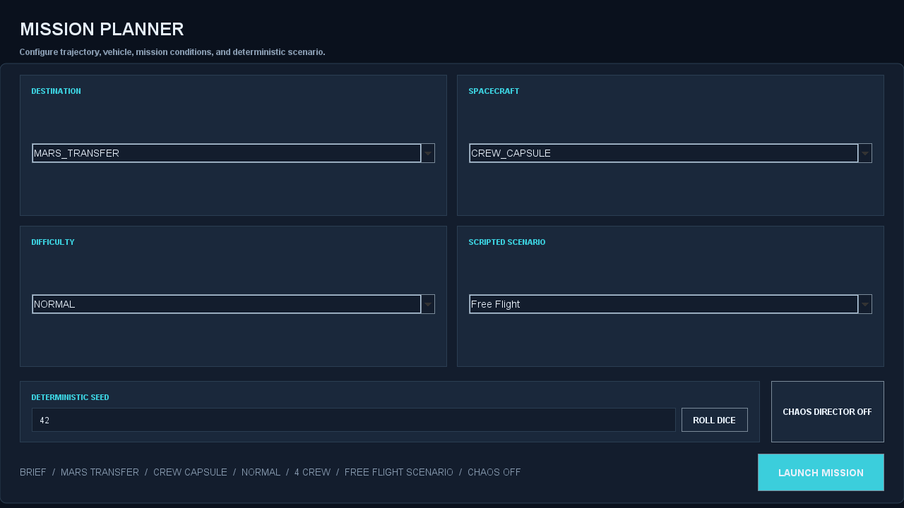
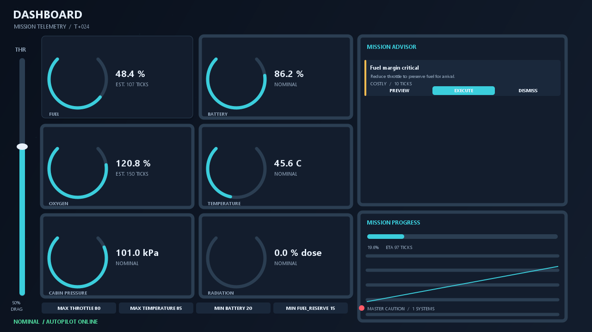
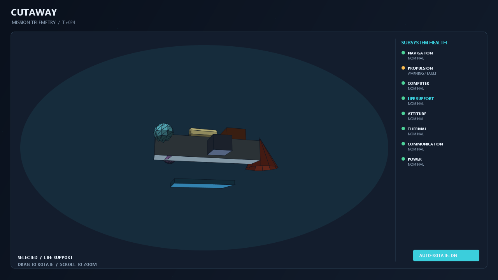
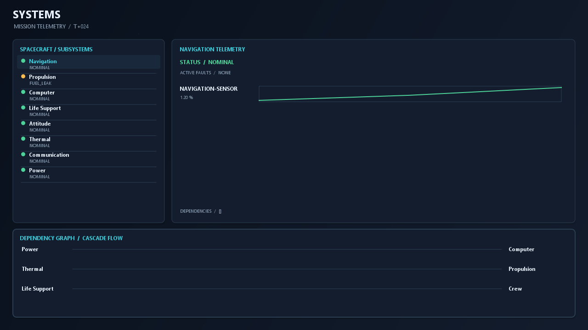
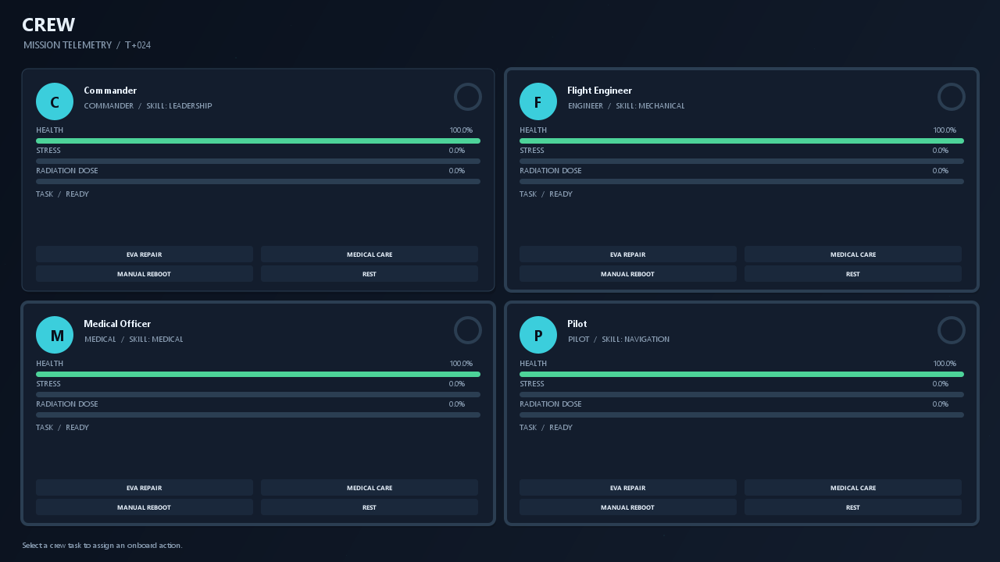
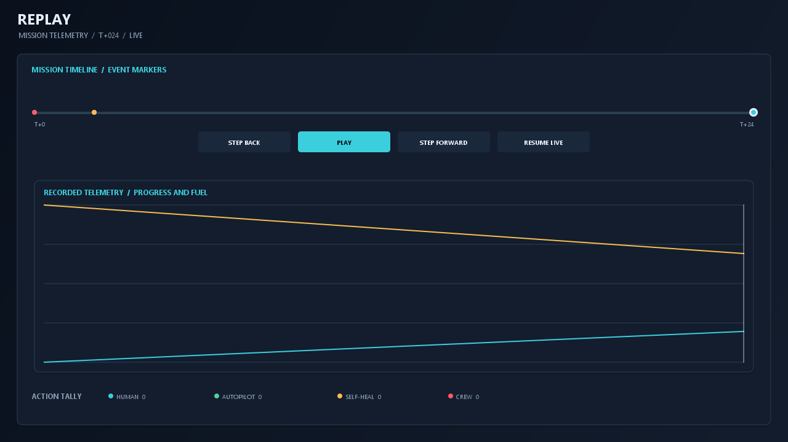
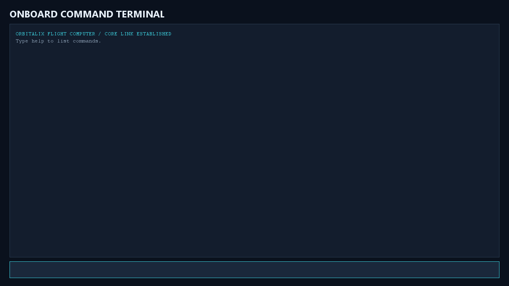
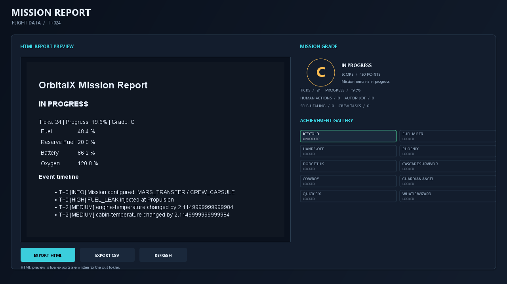

# OrbitalX — Space Mission Simulator: User Guide

> **Official Flight Operations Manual**: A complete, beginner-friendly guide to commanding the simulator — how to build, launch, navigate cockpit screens, monitor telemetry, execute flight maneuvers, and resolve spacecraft emergencies.
>
> 📄 **Looking for the printable PDF version?** Download [**`docs/USER_GUIDE.pdf`**](USER_GUIDE.pdf).  
> 🏛️ **Looking for the software architecture manual?** See [**`docs/OOP_GUIDE.md`**](OOP_GUIDE.md).

---

## Table of Contents
1. [Introduction & Overview](#1-introduction--overview)
2. [Prerequisites & Quick Start](#2-prerequisites--quick-start)
   - [Windows (One-Click)](#windows-one-click)
   - [macOS / Linux](#macos--linux)
   - [Maven Build](#maven-build)
3. [Your First Mission: Step-by-Step Tutorial](#3-your-first-mission-step-by-step-tutorial)
4. [Exhaustive Screen-by-Screen Reference](#4-exhaustive-screen-by-screen-reference)
   - [1. Flight Planner](#1-flight-planner)
   - [2. Flight Dashboard (Primary Cockpit)](#2-flight-dashboard-primary-cockpit)
   - [3. 3D Cutaway View](#3-3d-cutaway-view)
   - [4. Orbit & Trajectory Map](#4-orbit--trajectory-map)
   - [5. Systems Topology Tree](#5-systems-topology-tree)
   - [6. Crew Quarters & Tasking](#6-crew-quarters--tasking)
   - [7. Time-Travel Replay](#7-time-travel-replay)
   - [8. Avionics Terminal Console](#8-avionics-terminal-console)
   - [9. Mission Reports & Analytics](#9-mission-reports--analytics)
   - [10. Settings & Theme Customization](#10-settings--theme-customization)
5. [The Autonomous Resolution Protocol](#5-the-autonomous-resolution-protocol)
6. [Keyboard Shortcuts Reference](#6-keyboard-shortcuts-reference)
7. [Terminal CLI Command Reference](#7-terminal-cli-command-reference)
8. [Flight Scenarios & Difficulty Tiers](#8-flight-scenarios--difficulty-tiers)
9. [Troubleshooting & FAQs](#9-troubleshooting--faqs)

---

## 1. Introduction & Overview

**OrbitalX** is an aerospace mission-control desktop application and command-line simulator written in pure Java 17. It models:
- **Real-Time Spacecraft Telemetry**: Speed, altitude, fuel levels, battery storage, cabin oxygen, temperature, pressure, and CO₂ levels.
- **Dynamic Physics & Consumables**: Rule-based orbital simulation with speed-of-light radio delay, radiator heat rejection, and engine burn economics.
- **Space Hazards & Fault Injection**: Solar flares, hull micrometeoroid breaches, gyroscope drift, sensor noise, and engine flameouts.
- **Autonomous Recovery**: A 4-tier Chain of Responsibility that diagnoses telemetry anomalies and executes remediation commands.

---

## 2. Prerequisites & Quick Start

OrbitalX requires **zero external frameworks** and **zero internet access**. Everything is built using standard Java libraries (`java.awt`, `javax.swing`, `java.time`, `java.nio`).

### System Requirements
- **Java Development Kit (JDK)**: Version 17 or higher (Oracle OpenJDK, Eclipse Temurin, Amazon Corretto, or Microsoft Build).
- **Operating System**: Windows 10/11, macOS 11+, or modern Linux (Ubuntu, Debian, Fedora, Arch).
- **RAM**: Minimum 512 MB available.

---

### Windows (One-Click)
Open PowerShell or Command Prompt in the project root:

```powershell
# 1. Compile all Java source files
.\compile.bat

# 2. Launch the desktop GUI
.\run.bat
```

To run the interactive Command-Line Terminal:
```powershell
.\run.bat --cli
```

To run the automated verification test harness:
```powershell
.\run.bat --selftest
```

---

### macOS / Linux
Open a terminal in the project directory:

```bash
# 1. Make scripts executable
chmod +x compile.sh run.sh

# 2. Compile and launch GUI
./compile.sh
./run.sh
```

---

### Maven Build
If you prefer standard Maven builds:

```bash
# Compile and package into a JAR
mvn clean package

# Run the packaged application
java -jar target/orbitalx-1.0.0.jar
```

---

## 3. Your First Mission: Step-by-Step Tutorial

Follow these steps to successfully launch and complete your first space flight:

1. **Launch the Application**: Run `.\run.bat`. You will see the animated Mission Control splash screen followed by the **Flight Planner**.
2. **Configure Your Vessel**:
   - Destination: Select **Moon Orbital Insertion** (80 distance units).
   - Spacecraft: Choose **Explorer Class** (balanced fuel, 3-astronaut crew).
   - Difficulty: Pick **Normal** (standard operational rules).
3. **Ignition**: Click the green **"COMMENCE MISSION"** button at the bottom right.
4. **Throttle Up**: The simulator navigates automatically to the **Dashboard**. Drag the vertical **Throttle Lever** from 0% up to **75%**.
5. **Monitor Telemetry**: Watch the speed and altitude gauges climb. Keep an eye on the **Temperature Gauge** — if it approaches 85°C, throttle back to 40% or click the **"ACTIVATE RADIATORS"** button recommended by the Mission Advisor.
6. **Arrival**: When the distance remaining reaches zero, the simulator pauses and records your mission grade (**A+** for high fuel reserves and zero crew injuries).

---

## 4. Exhaustive Screen-by-Screen Reference

OrbitalX features **10 integrated mission screens**, accessible via the top navigation bar or keyboard shortcuts (`1` through `0`).

---

### 1. Flight Planner
*Shortcut: `1`*



The strategic staging area where missions are configured prior to launch:
- **Destination Matrix**: Moon Orbit (80 AU, 1-tick delay), Mars Transfer (120 AU, 3-tick delay), Asteroid Belt (160 AU, high debris hazard).
- **Spacecraft Class**:
  - *Explorer*: Balanced payload, 100% fuel, 3 crew members.
  - *Freighter*: Heavy 180% fuel tank, slower acceleration, 2 crew members.
  - *Crew Capsule*: Redundant life support, 4 crew members, emergency escape thrusters.
- **Lookahead Sandbox**: Preview estimated fuel consumption and travel duration before confirming launch.

---

### 2. Flight Dashboard (Primary Cockpit)
*Shortcut: `2`*



The central nerve center of the spacecraft during active flight:
- **6 Circular Arc Gauges**:
  - **Speed**: Current relative velocity (km/s).
  - **Altitude**: Orbital distance from launch body (km).
  - **Fuel Reserves**: Main and emergency reserve fuel percentage.
  - **Battery Storage**: Electrical bus charge percentage.
  - **Cabin Temperature**: Monitored in degrees Celsius (nominal: 20°C–25°C).
  - **Cabin Pressure**: Monitored in kiloPascals (nominal: 101.3 kPa).
- **Vertical Throttle Lever**: Drag with the mouse or use `Up`/`Down` arrow keys to adjust main engine burn rate (0% to 100%).
- **Operating Limit Sliders**: Set safety cutoffs for max temperature and minimum fuel before automatic safe mode activates.
- **Dynamic Advisor Panel**: Real-time diagnostic cards showing detected anomalies and one-click corrective actions.

---

### 3. 3D Cutaway View
*Shortcut: `3`*



A hardware-accelerated 3D wireframe and solid rasterizer built without OpenGL:
- **Interactive Rotation**: Left-click and drag with the mouse to orbit the camera around the spacecraft in 3D space.
- **Subsystem Highlighting**: Internal components (Propulsion, Reaction Wheels, Radiator Panels, Oxygen Scrubbers) pulse in green when nominal, amber when degraded, and flashing red when faulted.
- **Space Lighting**: Dual-source lighting modeling harsh direct sunlight and deep-space shadows.

---

### 4. Orbit & Trajectory Map
*Shortcut: `4`*


The astrodynamics navigation radar:
- **Orbital Ground Track**: Displays current orbital eccentricity, periapsis, and apoapsis.
- **Communication Cone**: Visualizes line-of-sight uplink windows with Earth ground stations. Outside the cone, radio delay increases dynamically.
- **Debris Corridor**: Radar sweep highlights incoming micrometeoroid swarms.

---

### 5. Systems Topology Tree
*Shortcut: `5`*



A comprehensive architectural tree showing component dependencies:
- **Subsystems Monitored**: Propulsion, Electrical Power, Thermal Rejection, Communication Link, Attitude Determination, Life Support, Flight Computer, Navigation.
- **Live Sparkline Charts**: 60-sample historical telemetry graphs for each subsystem.
- **Cascading Failure Paths**: Visual lines show how a power failure ripples into thermal radiators and navigation sensors.

---

### 6. Crew Quarters & Tasking
*Shortcut: `6`*



Manage astronaut health, stress, radiation exposure, and active assignments:
- **Commander**: Boosts overall spacecraft coordination and reduces crew panic during emergencies.
- **Flight Engineer**: Speeds up EVA repairs and mechanical fixes on propulsion and radiators.
- **Medical Officer**: Administers first aid to restore crew stamina and health.
- **Pilot**: Maintains manual attitude stabilization when gyroscopes fail.
- **Task Controls**: Assign astronauts to `EVA_REPAIR`, `SYSTEM_REBOOT`, `MEDICAL_TREATMENT`, or `MANDATORY_REST`.

---

### 7. Time-Travel Replay
*Shortcut: `7`*



Built on the **Memento Design Pattern**, this view enables full post-flight analysis:
- **Timeline Scrubber**: Drag backward in time to inspect any prior simulation tick.
- **Step-by-Step Playback**: Step frame-by-frame (`<` and `>`) to see exactly when an anomaly originated.
- **Branch Scenario**: Click "Fork Timeline" to simulate alternative decisions from any historical point.

---

### 8. Avionics Terminal Console
*Shortcut: `8`*



An authenticated, aviation-grade command line interface:
- **History Navigation**: Use `Up`/`Down` keys to recall previous commands.
- **Tab Auto-Completion**: Type `th` and press `Tab` to complete `throttle`.
- **Command Dispatch**: Inject faults, override safety limits, query diagnostics, and pause the mission clock directly from text commands.

---

### 9. Mission Reports & Analytics
*Shortcut: `9`*



Post-mission debriefing and certification audit exports:
- **Single-Click HTML5 Export**: Generates a responsive, CSS-styled mission report complete with timeline charts and flight grades.
- **CSV Telemetry Dump**: Exports raw telemetry values (tick, speed, altitude, fuel, pressure, temperature) for analysis in Excel or Python.
- **Mission Scorecard**: Evaluates flight efficiency, safety violations, and emergency response times to award a final mission grade (`A+` to `F`).

---

### 10. Settings & Theme Customization
*Shortcut: `0`*


Configure visual aesthetics and runtime behavior:
- **4 High-Contrast Mission Themes**:
  - **Dark Mission** (Default): Navy blue aerospace cockpit design.
  - **Lunar Light**: Crisp white projector theme for daylight viewing.
  - **Retro Amber**: CRT monochrome phosphorus glow.
  - **Cyberpunk Neon**: High-contrast purple and cyan palette.
- **Audio Synthesizer**: Toggle procedural audio waveforms (warning claxons, engine rumble, thruster clicks).
- **Simulation Speed**: Toggle tick rates between 1× (1 tick/sec), 2×, 5×, and 10× warp.

---

## 5. The Autonomous Resolution Protocol

OrbitalX models realistic aerospace autonomy through a **Four-Tier Chain of Responsibility**:

```text
[ Sensor Telemetry Anomaly Detected ]
                  |
                  v
       +-----------------------+
       |   1. Self-Healing     | ---> Restores circuit breakers or swaps backup fuel lines
       +-----------------------+      (Resolves within 2 ticks; zero human intervention)
                  | Unresolved
                  v
       +-----------------------+
       |   2. Timed Autopilot  | ---> Executes automated safety burn or throttles back engines
       +-----------------------+      (Waits for 5-tick confirmation window)
                  | Unresolved
                  v
       +-----------------------+
       |   3. Crew Tasking     | ---> Dispatches Flight Engineer on EVA or manual reboot
       +-----------------------+      (Depends on astronaut availability and stress)
                  | Unresolved
                  v
       +-----------------------+
       |   4. Ground Control   | ---> Radio uplink escalation; sounds critical audible claxon
       +-----------------------+
```

### Autonomy Selector (Dashboard)
- **MANUAL**: The pilot must click every corrective action manually.
- **TIMED_AUTOPILOT**: System highlights the action and executes it automatically after a countdown if unaddressed.
- **FULL_AUTO**: All four tiers operate autonomously to guarantee mission survival.

---

## 6. Keyboard Shortcuts Reference

| Key | Action |
| :--- | :--- |
| `Space` | Pause / Resume simulation clock |
| `Up` / `Down` | Increment / Decrement engine throttle by 5% |
| `1` – `0` | Switch directly to Screens 1 through 10 |
| `R` | Reset simulation to initial scenario state |
| `T` | Step forward by exactly one simulation tick |
| `F` | Toggle fullscreen mode |
| `+` / `-` | Increase / Decrease simulation clock speed |
| `Escape` | Dismiss active emergency dialog or cancel action |

---

## 7. Terminal CLI Command Reference

Access the console via Screen 8 or by running `.\run.bat --cli`:

| Command | Arguments | Description |
| :--- | :--- | :--- |
| `help` | — | Lists all available console commands |
| `status` | — | Prints full telemetry snapshot (fuel, battery, temperature, state) |
| `throttle` | `<0-100>` | Sets engine burn throttle percentage |
| `tick` | `[count]` | Advances the simulation clock by 1 (or `count`) ticks |
| `pause` | — | Pauses simulation clock |
| `resume` | — | Resumes simulation clock |
| `speed` | `<1-10>` | Adjusts ticks-per-second execution speed |
| `autonomy` | `<MANUAL\|TIMED\|AUTO>` | Changes active autonomy resolution policy |
| `heal` | `<on\|off>` | Enables or disables hardware self-healing circuits |
| `inject` | `<target> <type>` | Manually triggers a failure (e.g., `inject Thermal SPIKE`) |
| `crew` | `<name> <task>` | Tasks an astronaut (e.g., `crew Sarah EVA_REPAIR`) |
| `limits` | `<type> <value>` | Overrides operating safety bounds |
| `report` | — | Generates and exports HTML mission dossier to `out/` |
| `quit` | — | Exits the simulator |

---

## 8. Flight Scenarios & Difficulty Tiers

The simulator includes **12 pre-programmed flight scenarios**:

1. **Free Flight**: Clean operational baseline for flight practice and speed runs.
2. **Fuel Leak**: Punctured main tank requires cross-feeding emergency reserve before burn-out.
3. **Engine Trouble**: Thruster combustion instability halves engine efficiency.
4. **Power Crisis**: Solar panel micro-meteoroid strike drains battery bus.
5. **Lost in Space**: Attitude reaction wheels seize; requires manual RCS thruster alignment.
6. **Antenna Blackout**: Deep-space radio blackout increases uplink command delay.
7. **Hull Breach**: Sudden decompression requires sealing gel before cabin pressure reaches vacuum.
8. **Solar Storm**: High cosmic radiation spikes cabin temperature and risks crew sickness.
9. **Debris Alert**: Dense asteroid fragments require evasive maneuvers.
10. **Computer Crash**: Flight computer kernel panic requires cold reboot.
11. **Cascading Failure**: Thermal failure overheats avionics, causing compound power failures.
12. **Endless Chaos**: Randomized dynamic faults test maximum pilot survival endurance.

---

## 9. Troubleshooting & FAQs

#### Q: The simulation starts but the spacecraft is not moving.
**A:** Check your throttle level. After clicking *Commence Mission*, the engine defaults to 0% throttle. Drag the throttle lever up on the Dashboard or press the `Up` arrow key.

#### Q: Why did the engine shut off automatically?
**A:** If cabin temperature exceeds the maximum safe limit (100°C by default) or battery charge drops below 10%, the spacecraft automatically transitions to **SAFE MODE** to protect life support. Open the **Systems View**, activate radiators, and wait for cooling before throttling up again.

#### Q: How do I recover from an emergency hull breach?
**A:** Immediately click **"SEAL BREACH"** on the Dashboard Advisor card, or switch Autonomy to **FULL_AUTO**. You can also assign the Flight Engineer to `EVA_REPAIR` in the Crew screen.

#### Q: Where are exported reports and logs saved?
**A:** Reports and event logs are saved to the `out/` directory in the project root:
- HTML reports: `out/mission-report.html`
- Telemetry CSV: `out/telemetry.csv`
- Event transcript: `out/mission-events.log`

---

*OrbitalX Flight Operations Manual · Pure Java 17 · Zero Runtime Dependencies*
